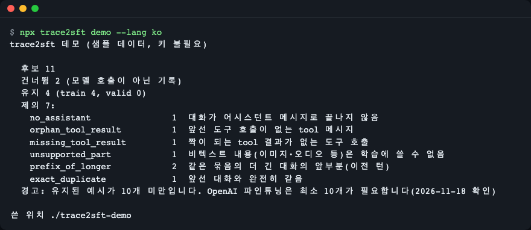
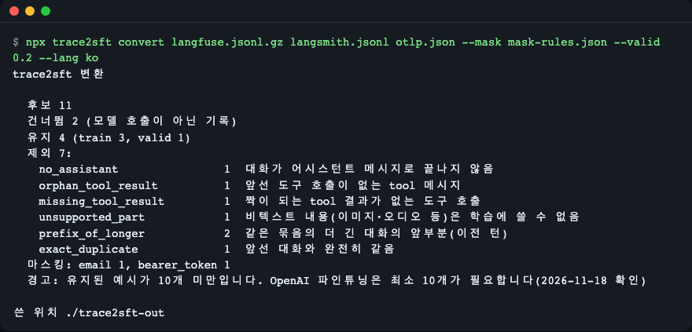
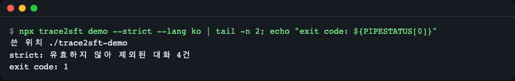
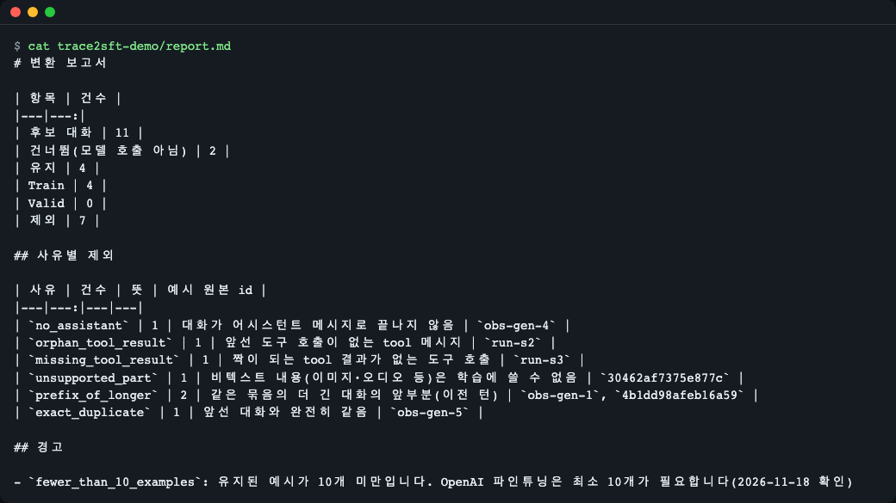
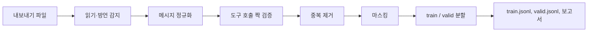

# trace2sft

[English](README.md) | **한국어**

Langfuse·LangSmith·OpenTelemetry GenAI 내보내기 파일을 검증된 파인튜닝용 chat JSONL 로 바꾸고, 무엇을 왜 뺐는지 보고서로 알려 줍니다. API 키도 네트워크도 필요 없고 런타임 의존성이 0개입니다.


*동봉된 데모: 내보내기 3종에서 후보 대화 11개를 다시 이어 붙여 4개는 유지하고 7개는 사유와 함께 제외합니다.*

## 이런 분께

- 운영 중인 LLM 호출을 Langfuse·LangSmith·OpenTelemetry 로 기록하고 있고, 그 기록으로 작은 모델을 파인튜닝하거나 평가 세트를 만들고 싶은 분
- 파인튜닝 업로드가 알 수 없는 400 오류로 거부돼서, 어떤 대화가 깨졌는지(예: 결과가 없는 도구 호출) 알고 싶은 분
- 데이터셋 만드는 단계를 CI 에서 돌려 나쁜 데이터가 있으면 실패시키고 싶은 분(`--strict`)

## 왜 필요한가

운영 로그는 파인튜닝 데이터의 가장 좋은 원천이지만 그대로는 쓸 수 없습니다.

- 기록된 호출 하나에는 대화의 일부만 들어 있고, 같은 대화가 턴마다 다시 저장됩니다(호출마다 앞선 턴이 반복됨).
- 제공자마다 메시지 모양이 다릅니다(OpenAI `tool_calls`, Anthropic `tool_use` 블록, OpenTelemetry `parts`).
- 도구 호출과 도구 결과의 짝이 끊긴 기록이 섞여 있고, 파인튜닝 업로드는 이를 원인 설명 없이 400 오류로 거부합니다.

Langfuse 는 이를 위해 OpenAI-JSONL 내보내기를 제공했다가, 파인튜닝용 데이터 표준화가 너무 복잡해졌다며 중단했습니다([변경 기록](https://langfuse.com/changelog/2023-09-18-export-generations), 2026-11-18 확인). trace2sft 는 세 가지 출처에 대해 이 단계를 해 주고, 무엇을 뺐는지 알려 줍니다.

## 설치

Node.js 22 이상이 필요합니다(`brew install node`, 또는 <https://nodejs.org>).

```bash
npx trace2sft demo
```

`npx` 가 패키지를 받아 한 번 실행하며 따로 설치되는 것은 없습니다. 라이브러리로 쓰려면 `npm install trace2sft`.

레포를 clone 해서 실행하려면:

```bash
git clone https://github.com/LeeGyeongPil/trace2sft && cd trace2sft
npm install && npm run build
node dist/cli.js demo
```

## 빠르게 시작하기

```bash
npx trace2sft demo --lang ko
```

```text
trace2sft 데모 (샘플 데이터, 키 불필요)

  후보 11
  건너뜀 2 (모델 호출이 아닌 기록)
  유지 4 (train 4, valid 0)
  제외 7:
    no_assistant                1  대화가 어시스턴트 메시지로 끝나지 않음
    orphan_tool_result          1  앞선 도구 호출이 없는 tool 메시지
    missing_tool_result         1  짝이 되는 tool 결과가 없는 도구 호출
    unsupported_part            1  비텍스트 내용(이미지·오디오 등)은 학습에 쓸 수 없음
    prefix_of_longer            2  같은 묶음의 더 긴 대화의 앞부분(이전 턴)
    exact_duplicate             1  앞선 대화와 완전히 같음
  경고: 유지된 예시가 10개 미만입니다. OpenAI 파인튜닝은 최소 10개가 필요합니다(2026-11-18 확인)

쓴 위치 ./trace2sft-demo
```

데모는 작은 샘플 내보내기를 변환합니다(각 도구의 문서에 나온 형태를 따라 손으로 쓴 것이며 실제 운영 데이터가 아닙니다). `./trace2sft-demo` 에 `train.jsonl`(유지된 대화), `report.json`, `report.md` 를 씁니다. 샘플이 작아서 경고가 뜨는 것은 정상입니다.

- **후보**: 모델 호출 기록에서 다시 이어 붙인 대화
- **건너뜀**: 모델 호출이 아닌 기록(예: 일반 span)
- **제외**: 빠진 대화, 사유별로 한 줄

## 기록 내보내기

trace2sft 는 파일을 읽으므로 먼저 도구에서 기록을 꺼내야 합니다. 메시지 본문은 요청해야만 내보내기에 들어갑니다. 빠져 있으면 `E_NO_IO_FIELDS` 가 납니다([자주 겪는 문제](#자주-겪는-문제) 참고).

### Langfuse

blob 스토리지·예약 내보내기에서 `observations_v2` 테이블을 고르고, **io** 필드 그룹(`input`, `output`)과 **tools** 필드 그룹(`tool_calls`, `tool_definitions`)을 켠 뒤 JSONL 로 받으세요(gzip 은 `.jsonl.gz` 그대로 넣으면 됩니다). `io` 가 없으면 메시지가 없습니다. UI 의 CSV 내보내기는 아직 지원하지 않습니다. 출처: [blob 스토리지 내보내기](https://langfuse.com/docs/api-and-data-platform/features/export-to-blob-storage), [내보내기 필드](https://langfuse.com/docs/api-and-data-platform/features/blob-storage-export-fields.md)(2026-11-18 확인).

### LangSmith

LangSmith 에는 원시 run 을 내려받는 UI 버튼이 없으므로 SDK 로 가져와 한 줄에 run 하나씩 쓰세요. `run_type="llm"` run 만 남기며, 대화는 run 메타데이터 `thread_id`, `session_id`, `conversation_id` 로 묶습니다. JavaScript SDK 예시입니다(LangSmith 계정과 API 키가 필요해 trace2sft 제작자가 실행해 보지는 않았습니다. [run 데이터 형식](https://docs.langchain.com/langsmith/run-data-format)과 SDK 문서를 확인하세요, 2026-11-18 확인):

```js
import { Client } from 'langsmith';
import { createWriteStream } from 'node:fs';

const client = new Client();
const out = createWriteStream('runs.jsonl');
for await (const run of client.listRuns({ projectName: 'my-project', runType: 'llm' })) {
  out.write(JSON.stringify(run) + '\n');
}
out.end();
```

### OpenTelemetry

GenAI 속성 `gen_ai.input.messages`, `gen_ai.output.messages` 는 옵트인이며 기본으로는 기록되지 않습니다([GenAI span 규약](https://opentelemetry.io/docs/specs/semconv/gen-ai/gen-ai-spans/), 2026-11-18 확인, 확인한 사양은 v1.38.0). 계측 라이브러리에서 메시지 내용 캡처를 켜고(해당 라이브러리 문서 참고), span 을 OTLP JSON 으로 쓰세요. 예를 들어 OpenTelemetry Collector 의 `file` exporter 를 쓸 수 있습니다. 문서 하나짜리 `.json` 도, 줄마다 OTLP 문서 하나인 `.jsonl` 도 됩니다.

## 사용법

```bash
trace2sft convert <입력...> [옵션]
trace2sft demo [옵션]
```

| 옵션 | 하는 일 | 예 |
|---|---|---|
| `--from <방언>` | `auto`(기본), `langfuse`, `langsmith`, `otlp` | `--from otlp` |
| `--format <형식>` | `openai`(기본) 또는 `hf`(도구 호출 `arguments` 를 객체로) | `--format hf` |
| `--out <폴더>` | 출력 폴더(기본 `./trace2sft-out`, demo 는 `./trace2sft-demo`) | `--out data` |
| `--valid <0..0.5>` | `valid.jsonl` 로 보낼 대화 묶음 비율(기본 0) | `--valid 0.2` |
| `--seed <문자열>` | 결정적 분할용 시드(기본 `trace2sft`) | `--seed v2` |
| `--mask <rules.json>` | 정규식 마스킹 규칙 `[{name, pattern, flags?, replace}]` | `--mask mask-rules.json` |
| `--max-chars <n>` | n자보다 긴 대화 제외 | `--max-chars 20000` |
| `--plain-text <정책>` | Langfuse 행의 평문 input/output 을 `keep`(기본) 또는 `drop` | `--plain-text drop` |
| `--strict` | 유효하지 않아 제외된 대화가 있으면 종료 코드 1 | `--strict` |
| `--lang <en\|ko>` | 메시지 언어 | `--lang ko` |

종료 코드: 0 정상, 1 `--strict` 에서 유효하지 않은 대화 발견, 2 사용법·입력 오류(모델 호출을 하나도 못 찾은 입력 `E_NO_CANDIDATES` 포함).

입력은 `.jsonl`, `.json`, `.gz` 파일입니다. 방언은 파일마다 감지하므로 서로 다른 내보내기를 한 번에 섞어 넣을 수 있습니다.

### 시나리오 1: 내보내기 3개를 변환하고, 개인정보를 가리고, 검증 세트를 떼어 두기

```bash
trace2sft convert langfuse.jsonl.gz langsmith.jsonl otlp.json \
  --mask mask-rules.json --valid 0.2
```

파일 이름은 예시입니다. 저장소 샘플로 해 보려면 `fixtures/langfuse/observations_v2.jsonl.gz`, `fixtures/langsmith/runs.jsonl`, `fixtures/otlp/chat-spans.json` 과 `--mask fixtures/mask-rules.json` 을 쓰세요.


*유지된 4개 대화가 train 3 / valid 1 로 나뉩니다. `마스킹:` 줄은 규칙마다 몇 군데를 바꿨는지 알려 줍니다.*

마스킹은 유지된 대화에만 적용됩니다. 샘플에서는 이메일 주소가 `[EMAIL]`, bearer 토큰이 `Bearer [TOKEN]` 으로 바뀝니다. 분할은 대화 묶음 단위라서 한 대화의 턴이 두 파일에 나뉘어 들어가지 않습니다.

### 시나리오 2: 잘못된 데이터가 있으면 CI 를 실패시키기

```bash
trace2sft demo --strict | tail -n 2; echo "exit code: ${PIPESTATUS[0]}"
```

`PIPESTATUS` 배열은 bash 전용입니다. zsh 에서는 `${pipestatus[1]}` 를 쓰거나 `trace2sft demo --strict; echo "exit code: $?"` 로 실행하세요.


*`--strict` 는 "유효하지 않은 대화가 있었다"를 종료 코드 1 로 바꿉니다.*

구조가 잘못된 대화(도구 호출 짝 불일치, 마지막이 어시스턴트가 아님, 텍스트가 아닌 부분)만 셉니다. 중복·앞부분 대화는 실패로 치지 않습니다.

### 시나리오 3: 보고서 읽기


*`report.md` 는 사유마다 건수와 예시 원본 id 를 보여 주므로, 관측 도구에서 해당 기록을 찾아볼 수 있습니다.*

`report.json` 에는 스크립트용으로 같은 숫자가 들어 있고 언어에 따라 바뀌지 않습니다.

### 라이브러리

```js
import { convert, readTraceFiles, toJsonl } from 'trace2sft';

const input = await readTraceFiles(['observations_v2.jsonl.gz', 'runs.jsonl']);
const { train, report } = convert(input, { format: 'openai' });
console.log(`kept=${report.kept} dropped=${report.dropped_total}`);
```

`convert()` 는 파일을 읽지 않는 순수 함수입니다. 저장소의 `examples/library.mjs` 는 샘플 내보내기에서 `kept=4 dropped=7 skipped=2` 를 출력합니다.

| 내보내기 | 입력 | 출력 |
|---|---|---|
| `readTraceFiles(paths, opts?)` | 파일 경로, `{from, plainText}` | `Promise<ReadResult>`(후보, 건너뜀 수) |
| `fromRecords(records, dialect, opts?)` | 한 방언으로 파싱된 기록 | `ReadResult`(파일 접근 없음) |
| `detectDialect(records)` | 파싱된 기록 | `'langfuse' \| 'langsmith' \| 'otlp'` 또는 `undefined` |
| `convert(readResult, opts?)` | `{format, valid, seed, mask, maxChars}` | `{train, valid, report}` |
| `validateMessages(messages, opts?)` | chat 메시지 | 제외 사유 또는 `null` |
| `toJsonl(rows)` | 객체 배열 | JSONL 텍스트 |
| `renderReportMarkdown(report, lang)` | 보고서, `'en'` 또는 `'ko'` | Markdown 텍스트 |
| `loadMaskRules(path)` / `parseMaskRules(json)` | 파일 경로 / 파싱된 JSON | `MaskRule[]`(`Trace2SftError` 를 던짐) |
| `Trace2SftError` | | 고정된 `code` 가 있는 오류(`E_USAGE`, `E_INPUT_PARSE`, `E_UNKNOWN_DIALECT`, `E_NO_IO_FIELDS`, `E_BAD_MASK_RULE`, `E_NO_CANDIDATES`) |

## 설정

- **언어**: `--lang en|ko`, 그다음 환경 변수 `TRACE2SFT_LANG`, 그다음 `LC_ALL` / `LC_MESSAGES` / `LANG`. 한국어가 아니면 영어입니다. 터미널 출력, 인자 오류 메시지, `report.md` 가 따릅니다.
- **마스킹 규칙**(`--mask`): JSON 배열입니다. 예:

```json
[
  { "name": "email", "pattern": "[A-Za-z0-9._%+-]+@[A-Za-z0-9.-]+\\.[A-Za-z]{2,}", "replace": "[EMAIL]" },
  { "name": "bearer_token", "pattern": "Bearer\\s+[A-Za-z0-9._~+/=-]+", "replace": "Bearer [TOKEN]" }
]
```

실제 모드·목(mock) 모드 구분은 없습니다. 주신 파일만 읽습니다.

## 동작 원리



1. **읽기**: Langfuse `observations_v2` 행, LangSmith run, OTLP JSON 을 파일마다 감지합니다.
2. **정규화**: OpenAI·Anthropic 콘텐츠 블록·OTel parts 메시지를 OpenAI chat 메시지로 바꿉니다. id 가 없는 도구 호출에는 항상 같은 값이 나오는 id 를 만들어 붙입니다.
3. **검증**: 도구 호출마다 tool 결과가 정확히 하나 있어야 하고, 짝 없는 tool 메시지가 없어야 하며, 대화가 어시스턴트 턴으로 끝나야 합니다.
4. **중복 제거**: 검증 뒤에, 같은 묶음의 더 긴 대화의 앞부분인 대화와 완전히 같은 대화를 뺍니다(검증을 먼저 해야 깨진 기록이 멀쩡한 짧은 기록을 삼키지 않습니다).
5. **마스킹·분할**: 유지된 대화에 정규식 마스킹을 하고, 시드 기반으로 대화 묶음 단위로 나눕니다.
6. **쓰기**: JSONL 과 사유별 보고서.

## 무엇이 왜 제외되나

후보 대화는 모두 유지되거나, 사유와 함께 제외됩니다. 아래 10개가 `report.md`·`report.json` 에 나오는 사유 코드입니다.

| 사유 | 뜻 | 예 | `--strict` |
|---|---|---|---|
| `no_assistant` | 어시스턴트 메시지로 끝나지 않음 | 출력이 기록되지 않음 | 센다 |
| `orphan_tool_result` | 앞선 도구 호출이 없는 `tool` 메시지 | 트리밍으로 호출이 잘려 나감 | 센다 |
| `missing_tool_result` | 짝이 되는 결과가 없는 도구 호출 | 도구 실행 중 앱이 죽음 | 센다 |
| `tool_result_not_adjacent` | 결과가 호출과 다른 메시지로 떨어져 있음 | 호출과 결과 사이의 user 메시지 | 센다 |
| `empty_message` | 내용이 빈 메시지가 있음 | user 턴의 `"content": ""` | 센다 |
| `unsupported_part` | 이미지·오디오 등 비텍스트 내용 | 이미지가 든 user 턴 | 센다 |
| `too_long` | `--max-chars` 보다 김 | `--max-chars 20000` 에서 30,000자 대화 | 센다 |
| `unparseable_io` | 입력·출력을 메시지로 읽을 수 없음 | 깨진 JSON 문자열인 Langfuse `input` | 센다 |
| `prefix_of_longer` | 같은 묶음의 더 긴 대화의 앞부분 | 3턴 대화의 1턴 | 세지 않는다 |
| `exact_duplicate` | 앞선 대화와 완전히 같음 | 같은 프롬프트가 두 번 기록됨 | 세지 않는다 |

`--strict` 는 "센다" 행의 사유로 제외된 대화가 하나라도 있으면 종료 코드 1 을 냅니다.

## 언제 쓰나

- 잘 맞는 경우: Langfuse·LangSmith 내보내기나 OTel `gen_ai.*` span 이 이미 있고, 믿을 수 있는 chat 형식 SFT 데이터가 필요할 때.
- 아직 다루지 않는 것: [한계](#한계) 참고.
- 다른 도구: 트레이스를 모으고 살펴보려면 [Langfuse](https://langfuse.com)·[LangSmith](https://smith.langchain.com), 파인튜닝 작업 실행은 모델 제공자의 도구를 쓰세요. trace2sft 는 데이터셋 준비만 합니다.

## 한계

- 전부 메모리에 올리므로 아주 큰 내보내기는 먼저 나눠야 합니다.
- 아직 지원하지 않음: 구형 OpenTelemetry 이벤트 방식 방언, Gemini 식 메시지, Langfuse CSV(예정). OpenTelemetry 속성 이름은 시맨틱 규약 v1.38.0 문서와 `@opentelemetry/semantic-conventions` 1.45.0 패키지 기준으로 확인했습니다(2026-11-18).
- `--format hf` 는 도구 호출 `arguments` 를 객체로 씁니다. 도구마다 인자 모양이 다르면 Hugging Face `datasets`(Arrow)로 읽을 때 스키마 충돌이 날 수 있으니 그럴 땐 `--format openai` 를 쓰세요.
- 마스킹은 정규식 규칙뿐입니다. 개인정보를 자동으로 찾지 않으므로 데이터셋을 공유하기 전에 규칙과 결과를 직접 확인하세요.
- 구조만 검사하며 품질은 보지 않습니다. 형식이 맞는 대화도 나쁜 학습 예시일 수 있습니다.

## 자주 겪는 문제

| 증상 | 원인 | 해결 |
|---|---|---|
| `error [E_UNKNOWN_DIALECT]` 와 종료 코드 2 | 인식할 수 없는 내보내기 파일 | Langfuse observations, LangSmith runs, OTLP JSON 파일인지 확인하거나 `--from` 으로 지정 |
| `error [E_NO_IO_FIELDS]` 와 종료 코드 2 | 내보내기에 메시지 본문이 없음 | Langfuse: `io`(와 `tools`) 필드 그룹을 켜고 다시 내보내기. OpenTelemetry: 메시지 내용 캡처 켜기. [기록 내보내기](#기록-내보내기) 참고 |
| `error [E_INPUT_PARSE]` 와 종료 코드 2 | 줄(`.jsonl`) 또는 파일 전체(`.json`)가 올바른 JSON 이 아님, 다운로드가 잘린 경우가 많음 | 다시 내보내기. `.jsonl` 은 메시지에 문제의 줄 번호가 나옴 |
| `error [E_BAD_MASK_RULE]` 와 종료 코드 2 | `--mask` 파일의 규칙에 `name`·`pattern`·`replace` 가 없거나 정규식이 잘못됨 | 메시지가 가리키는 규칙을 고치기(규칙 번호는 0부터) |
| `error [E_NO_CANDIDATES]` 와 종료 코드 2 | 모든 입력에 모델 호출 기록이 없음: 빈 파일이거나 `--from` 이 파일과 안 맞음 | 내보내기가 비어 있지 않은지 확인, `--from auto` 로 시도 |
| `경고: <파일>: 모델 호출 기록을 찾지 못했습니다` | 여러 파일 중 하나에 기록이 없음 | 그 파일의 내보내기나 `--from` 확인 |
| `경고: <파일>: 파일이 비어 있어 읽은 내용이 없습니다` | 여러 파일 중 하나가 비어 있음 | 다시 내보내거나 그 파일을 빼기 |
| `no_assistant` 로 많이 제외됨 | 대화가 어시스턴트 메시지로 끝나지 않음(예: 출력이 기록되지 않음) | 내보내기에 모델 출력이 들어 있는지 확인 |
| `경고: 유지된 예시가 10개 미만` | 파인튜닝 최소 개수 | 데이터를 더 변환 |

## 개발·기여

```bash
npm install
npm test
npm run gen:otlp && node --test test/otlp.test.mjs   # OTLP 픽스처를 다시 만듭니다. 안 하면 그 테스트는 건너뜁니다
```

버그·제안은 이슈로 남겨 주세요. 변경 기록은 [CHANGELOG.md](CHANGELOG.md).

## 라이선스

MIT. 동봉된 샘플 내보내기는 손으로 쓴 것이며 실제 데이터가 없습니다.
