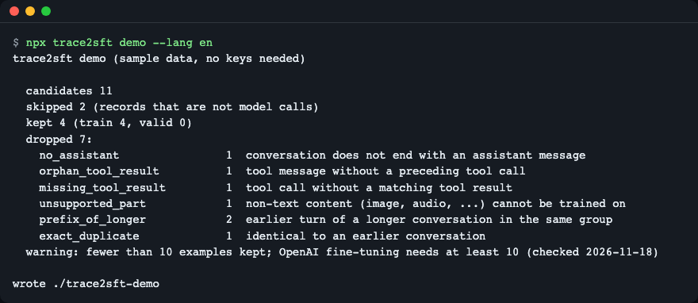
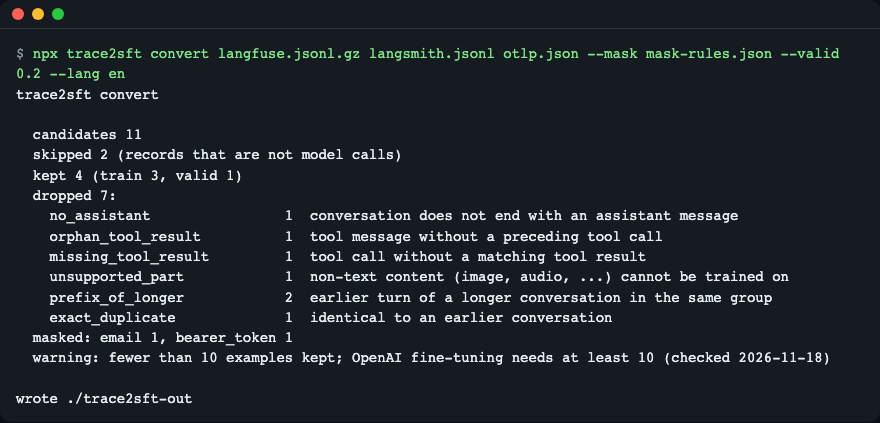
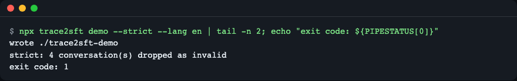
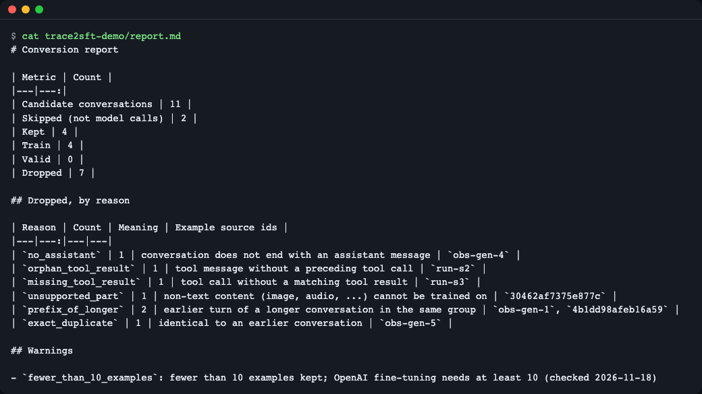
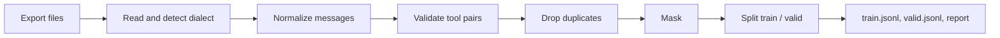

# trace2sft

**English** | [한국어](README.ko.md)

Turn Langfuse, LangSmith and OpenTelemetry GenAI exports into validated fine-tuning chat JSONL, with a report that says what was dropped and why. It needs no API key, no network and has zero runtime dependencies.


*The bundled demo: 11 candidate conversations are rebuilt from three exports, 4 are kept, 7 are dropped with a reason each.*

## Who it is for

- You log production LLM calls with Langfuse, LangSmith or OpenTelemetry and want to fine-tune a smaller model or build an eval set from them.
- A fine-tuning upload was rejected with a vague 400 error and you want to know which conversations are broken (for example a tool call with no tool result).
- You want a dataset step you can run in CI and fail on bad data (`--strict`).

## Why

Production logs are the best source of fine-tuning data, but they cannot be used as they are:

- One logged call holds only part of a conversation, and the same conversation is stored again for every turn (each call repeats the earlier turns).
- Providers shape messages differently (OpenAI `tool_calls`, Anthropic `tool_use` blocks, OpenTelemetry `parts`).
- Tool calls and tool results get separated, and fine-tuning uploads reject those with an unspecific 400 error.

Langfuse used to offer an OpenAI-JSONL export for this and discontinued it, saying that standardizing data for fine-tuning had become too complex ([changelog](https://langfuse.com/changelog/2023-09-18-export-generations), checked 2026-11-18). trace2sft does that step for all three sources and tells you what it left out.

## Install

Node.js 22 or newer is required (`brew install node`, or see <https://nodejs.org>).

```bash
npx trace2sft demo
```

`npx` downloads and runs the package; nothing else is installed. To use it as a library, `npm install trace2sft`.

To run from a clone instead:

```bash
git clone https://github.com/LeeGyeongPil/trace2sft && cd trace2sft
npm install && npm run build
node dist/cli.js demo
```

## Quick start

```bash
npx trace2sft demo
```

```text
trace2sft demo (sample data, no keys needed)

  candidates 11
  skipped 2 (records that are not model calls)
  kept 4 (train 4, valid 0)
  dropped 7:
    no_assistant                1  conversation does not end with an assistant message
    orphan_tool_result          1  tool message without a preceding tool call
    missing_tool_result         1  tool call without a matching tool result
    unsupported_part            1  non-text content (image, audio, ...) cannot be trained on
    prefix_of_longer            2  earlier turn of a longer conversation in the same group
    exact_duplicate             1  identical to an earlier conversation
  warning: fewer than 10 examples kept; OpenAI fine-tuning needs at least 10 (checked 2026-11-18)

wrote ./trace2sft-demo
```

The demo converts small sample exports (hand-written to follow each tool's documented shape, not real production data). It writes `train.jsonl` (the kept conversations), `report.json` and `report.md` into `./trace2sft-demo`. The warning is expected: the sample is tiny.

- **candidates**: conversations rebuilt from model-call records.
- **skipped**: records that are not model calls (for example a plain span).
- **dropped**: removed conversations, one line per reason.

## Export your traces

trace2sft reads files, so first get your records out of the tool. Message bodies are only in the export if you asked for them. If they are missing you get `E_NO_IO_FIELDS` (see [Troubleshooting](#troubleshooting)).

### Langfuse

Use the blob-storage / scheduled export with the `observations_v2` table, turn on the **io** field group (`input`, `output`) and the **tools** field group (`tool_calls`, `tool_definitions`), and pick JSONL (gzip is fine, pass the `.jsonl.gz` as is). Without `io` there are no messages. The UI CSV export is not supported yet. Sources: [export to blob storage](https://langfuse.com/docs/api-and-data-platform/features/export-to-blob-storage), [export fields](https://langfuse.com/docs/api-and-data-platform/features/blob-storage-export-fields.md) (checked 2026-11-18).

### LangSmith

LangSmith has no UI button for raw runs, so pull them with the SDK and write one run per line. Keep only `run_type="llm"` runs; conversations are grouped by the run metadata `thread_id`, `session_id` or `conversation_id`. Sketch with the JavaScript SDK (needs your LangSmith account and API key, not run by the trace2sft authors; check the [run data format](https://docs.langchain.com/langsmith/run-data-format) and SDK docs, checked 2026-11-18):

```js
import { Client } from 'langsmith';
import { createWriteStream } from 'node:fs';

const client = new Client();
const out = createWriteStream('runs.jsonl');
for await (const run of client.listRuns({ projectName: 'my-project', runType: 'llm' })) {
  out.write(JSON.stringify(run) + '\n');
}
out.end();
```

### OpenTelemetry

The GenAI attributes `gen_ai.input.messages` and `gen_ai.output.messages` are opt-in and not recorded by default ([GenAI span conventions](https://opentelemetry.io/docs/specs/semconv/gen-ai/gen-ai-spans/), checked 2026-11-18; the spec checked was v1.38.0). Turn on message content capture in your instrumentation library (see its documentation), then write the spans as OTLP JSON, for example with the OpenTelemetry Collector `file` exporter. A `.json` file with one document or a `.jsonl` file with one OTLP document per line both work.

## Usage

```bash
trace2sft convert <input...> [options]
trace2sft demo [options]
```

| Option | What it does | Example |
|---|---|---|
| `--from <dialect>` | `auto` (default), `langfuse`, `langsmith`, `otlp` | `--from otlp` |
| `--format <format>` | `openai` (default) or `hf` (tool-call `arguments` as objects) | `--format hf` |
| `--out <dir>` | Output directory (default `./trace2sft-out`, demo: `./trace2sft-demo`) | `--out data` |
| `--valid <0..0.5>` | Share of conversation groups sent to `valid.jsonl` (default 0) | `--valid 0.2` |
| `--seed <text>` | Seed of the deterministic split (default `trace2sft`) | `--seed v2` |
| `--mask <rules.json>` | Regex masking rules `[{name, pattern, flags?, replace}]` | `--mask mask-rules.json` |
| `--max-chars <n>` | Drop conversations longer than n characters | `--max-chars 20000` |
| `--plain-text <p>` | `keep` (default) or `drop` plain-text input/output of Langfuse rows | `--plain-text drop` |
| `--strict` | Exit 1 if any conversation is dropped as invalid | `--strict` |
| `--lang <en\|ko>` | Message language | `--lang ko` |

Exit codes: 0 ok, 1 `--strict` found invalid conversations, 2 usage or input error (including an input that yields no model calls, `E_NO_CANDIDATES`).

Input files may be `.jsonl`, `.json` or `.gz`. The dialect is detected per file, so you can mix exports in one run.

### Scenario 1: convert three exports, mask personal data, hold out a validation set

```bash
trace2sft convert langfuse.jsonl.gz langsmith.jsonl otlp.json \
  --mask mask-rules.json --valid 0.2
```

The file names are placeholders. To try it on the repo samples, use `fixtures/langfuse/observations_v2.jsonl.gz`, `fixtures/langsmith/runs.jsonl`, `fixtures/otlp/chat-spans.json` and `--mask fixtures/mask-rules.json`.


*Same 4 kept conversations, now split 3 train / 1 valid. The `masked:` line says how many matches each rule replaced.*

Masking runs on kept conversations only. In the sample, an e-mail address became `[EMAIL]` and a bearer token became `Bearer [TOKEN]`. The split works per conversation group, so turns of one conversation never land in both files.

### Scenario 2: fail a CI job on invalid data

```bash
trace2sft demo --strict | tail -n 2; echo "exit code: ${PIPESTATUS[0]}"
```

The `PIPESTATUS` array is bash-only. In zsh use `${pipestatus[1]}`, or simply run `trace2sft demo --strict; echo "exit code: $?"`.


*`--strict` turns "some conversations were invalid" into exit code 1.*

Only conversations that are structurally invalid (broken tool-call pairing, no final assistant message, non-text parts) count. Duplicates and shorter prefixes do not fail the run.

### Scenario 3: read the report


*`report.md` lists each reason with a count and example source ids so you can look the records up in your observability tool.*

`report.json` has the same numbers for scripts and does not change with the language.

### Library

```js
import { convert, readTraceFiles, toJsonl } from 'trace2sft';

const input = await readTraceFiles(['observations_v2.jsonl.gz', 'runs.jsonl']);
const { train, report } = convert(input, { format: 'openai' });
console.log(`kept=${report.kept} dropped=${report.dropped_total}`);
```

`convert()` is a pure function: it reads no files. The repository's `examples/library.mjs` prints `kept=4 dropped=7 skipped=2` on the sample exports.

| Export | Input | Output |
|---|---|---|
| `readTraceFiles(paths, opts?)` | file paths, `{from, plainText}` | `Promise<ReadResult>` (candidates, skipped count) |
| `fromRecords(records, dialect, opts?)` | parsed records of one dialect | `ReadResult` (no file access) |
| `detectDialect(records)` | parsed records | `'langfuse' \| 'langsmith' \| 'otlp'` or `undefined` |
| `convert(readResult, opts?)` | `{format, valid, seed, mask, maxChars}` | `{train, valid, report}` |
| `validateMessages(messages, opts?)` | chat messages | a drop reason or `null` |
| `toJsonl(rows)` | array of objects | JSONL text |
| `renderReportMarkdown(report, lang)` | report, `'en'` or `'ko'` | Markdown text |
| `loadMaskRules(path)` / `parseMaskRules(json)` | file path / parsed JSON | `MaskRule[]` (throws `Trace2SftError`) |
| `Trace2SftError` | | error with a stable `code` (`E_USAGE`, `E_INPUT_PARSE`, `E_UNKNOWN_DIALECT`, `E_NO_IO_FIELDS`, `E_BAD_MASK_RULE`, `E_NO_CANDIDATES`) |

## Configuration

- **Language**: `--lang en|ko`, then the `TRACE2SFT_LANG` environment variable, then `LC_ALL` / `LC_MESSAGES` / `LANG`. Anything that is not Korean falls back to English. The terminal output and `report.md` follow it.
- **Masking rules** (`--mask`): a JSON array. Example:

```json
[
  { "name": "email", "pattern": "[A-Za-z0-9._%+-]+@[A-Za-z0-9.-]+\\.[A-Za-z]{2,}", "replace": "[EMAIL]" },
  { "name": "bearer_token", "pattern": "Bearer\\s+[A-Za-z0-9._~+/=-]+", "replace": "Bearer [TOKEN]" }
]
```

There is no real mode and no mock mode: the tool only reads files you give it.

## How it works



1. **Read**: Langfuse `observations_v2` rows, LangSmith runs or OTLP JSON are detected per file.
2. **Normalize**: OpenAI, Anthropic content-block and OTel parts messages become OpenAI chat messages. Tool calls without an id get a synthesized stable one.
3. **Validate**: every tool call needs exactly one matching tool result, no orphan tool messages, and the conversation must end with an assistant turn.
4. **Dedupe**: after validation, a conversation that is the prefix of a longer one in the same group, and exact duplicates, are removed (validating first keeps a broken record from swallowing a good short one).
5. **Mask and split**: regex masking on what is kept, then a seeded split by conversation group.
6. **Write**: JSONL plus a per-reason report.

## What gets dropped and why

Every candidate conversation is either kept or dropped with a reason. These are the 10 reason codes you can see in `report.md` and `report.json`.

| Reason | Meaning | Example | `--strict` |
|---|---|---|---|
| `no_assistant` | Does not end with an assistant message | The output was not logged | counts |
| `orphan_tool_result` | A `tool` message with no earlier tool call | The call was cut off by trimming | counts |
| `missing_tool_result` | A tool call with no matching result | The app crashed in the tool | counts |
| `tool_result_not_adjacent` | The result is separated from its call by another message | A user message between call and result | counts |
| `empty_message` | A message has empty content | `"content": ""` on a user turn | counts |
| `unsupported_part` | Image, audio or other non-text content | A user turn with an image | counts |
| `too_long` | Longer than `--max-chars` | A 30,000-character conversation with `--max-chars 20000` | counts |
| `unparseable_io` | Input or output could not be read as messages | A Langfuse `input` that is a broken JSON string | counts |
| `prefix_of_longer` | Earlier turn of a longer conversation in the same group | Turn 1 of a 3-turn chat | does not count |
| `exact_duplicate` | Identical to an earlier conversation | The same prompt logged twice | does not count |

`--strict` exits 1 when anything in the "counts" rows was dropped.

## When to use it

- Good fit: you already have exports from Langfuse, LangSmith or OTel `gen_ai.*` spans and need chat-format SFT data you can trust.
- Not covered yet: see [Limits](#limits).
- Other tools: to collect and browse traces use [Langfuse](https://langfuse.com) or [LangSmith](https://smith.langchain.com); to run the fine-tuning job use your model provider's tooling. trace2sft only prepares the dataset.

## Limits

- Everything is loaded into memory; very large exports need splitting first.
- Not supported yet: older OpenTelemetry event-style dialects, Gemini-style messages, Langfuse CSV (planned). The OpenTelemetry attribute names were checked against the semantic conventions v1.38.0 document and the `@opentelemetry/semantic-conventions` 1.45.0 package (2026-11-18).
- `--format hf` writes tool-call `arguments` as objects. If different tools have different argument shapes, loading the file with Hugging Face `datasets` (Arrow) can fail with a schema conflict; use `--format openai` there.
- Masking is regex rules only. There is no automatic detection of personal data, so review the rules and the output before you share a dataset.
- It checks structure, not quality: a well-formed conversation can still be a bad training example.

## Troubleshooting

| Symptom | Cause | Fix |
|---|---|---|
| `error [E_UNKNOWN_DIALECT]` and exit 2 | The file is not a recognized export | Check it is a Langfuse observations, LangSmith runs or OTLP JSON file, or force it with `--from` |
| `error [E_NO_IO_FIELDS]` and exit 2 | The export has no message bodies | Langfuse: enable the `io` (and `tools`) field group and export again. OpenTelemetry: enable message content capture. See [Export your traces](#export-your-traces) |
| `error [E_INPUT_PARSE]` and exit 2 | A line (`.jsonl`) or the whole file (`.json`) is not valid JSON, often a truncated download | Export again; for `.jsonl` the message names the bad line |
| `error [E_BAD_MASK_RULE]` and exit 2 | A rule in the `--mask` file lacks `name`, `pattern` or `replace`, or the regex is invalid | Fix the rule the message points to (rules are numbered from 0) |
| `error [E_NO_CANDIDATES]` and exit 2 | No model-call records in any input: empty file, or `--from` does not match the file | Check the export is not empty; try `--from auto` |
| `warning: <file>: no model-call records found` | One of several files had none | Check that file's export or its `--from` value |
| `warning: <file>: the file is empty; nothing was read from it` | One of several files is empty | Export again or drop that file |
| Many conversations dropped as `no_assistant` | The conversation does not end with an assistant message (for example the output was not recorded) | Check that your export includes model outputs |
| `warning: fewer than 10 examples kept` | Provider minimum for fine-tuning | Convert more data |

## Development

```bash
npm install
npm test
npm run gen:otlp && node --test test/otlp.test.mjs   # regenerates the OTLP fixture; without it that test is skipped
```

Report bugs and ideas as issues. Changes are listed in [CHANGELOG.md](CHANGELOG.md).

## License

MIT. The bundled sample exports are hand-written and contain no real data.
